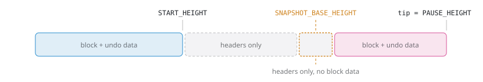
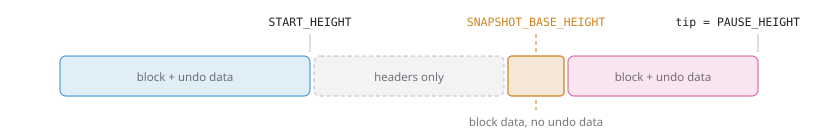

<!-- desc: Review notes for [#36503](https://github.com/bitcoin/bitcoin/pull/36503) -->
# Review [#36503](https://github.com/bitcoin/bitcoin/pull/36503)

## context

For each block that we validated and applied to the current chainstate, we keep on disk the "undo data", which is everything we need to undo a block and remove it from the chain - useful in case of a reorg, or in case we want to rollback the chain to create utxo set dump at a certain height.

During normal sync, we receive a block from p2p and we call `ProcessNewBlock`. This will do some validity checks, if they pass, write the block to disk (`AcceptBlock`). Then we will call `ActivateBestChain` on it, and if the block connects, we will write the undo data for it. Note that there might be edge cases (such as receiving blocks out of order) where we write the block data, and the undo data is written later or even never.

Assumeutxo is where things get a bit quirky :) A user uses `loadtxoutset` to load a snapshot for a certain block at height `SNAPSHOT_BASE_HEIGHT`. From there, Bitcoin Core will sync from `SNAPSHOT_BASE_HEIGHT + 1` to the tip - downloading the blocks from peers, connecting them to the chain, writing the undo data. At the same time, it will sync from genesis (or whatever block it was at when the snapshot was loaded, called `START_HEIGHT` in the test) to `SNAPSHOT_BASE_HEIGHT`.
This means that the last block to be connected in the background chainstate, and thus to ever have undo data, is (maybe surprisingly?) `SNAPSHOT_BASE_HEIGHT`.

## PR short summary

This PR explores the edge cases of rolling back when there is no undo data available.

The first two commits fix a bug where the node would crash if it was pruned and dumptxoutset was called when the chain tip had no undo data, which can happen if a txoutset has just been loaded.

The third commit:
- Relaxes the pre-existing check that to rollback to block N we need body and undo data for blocks [N...tip] - we actually don't, having the body+undo data for blocks [N+1...tip] is enough
- Includes nodes that are currently validating a loaded txoutset in the check, since they might also have missing undo data. This was already checked later, but checking it earlier is an optimization worth doing. 

---

## commit-by-commit review

### test: characterize snapshot rollback without tip data

> Record the assertion when the snapshot tip lacks block data or undo, then restart the node to continue the existing checks.

First check: rolling back to `SNAPSHOT_BASE_HEIGHT - 1` after the snapshot is loaded.
Upon loading the snapshot the tip becomes `SNAPSHOT_BASE_HEIGHT`, but we have no block data and no undo data for that block. Note that in the test n1 is isolated at this point, so it can't download the tip from any peer. 
When `m_blockman.GetFirstBlock` is called with `BLOCK_HAVE_MASK`, the current tip doesn't have block data or undo data, and the assertion crashes. 

Then we sync the current chainstate to reach height `PAUSE_HEIGHT`, which equals `FINAL_HEIGHT - 40`. We use `dumb_sync_blocks` for \[`SNAPSHOT_BASE_HEIGHT + 1, FINAL_HEIGHT - 40`] and a `submit_block` for `SNAPSHOT_BASE_HEIGHT`. The situation now is:
- blocks and undo for [`0`, `START_HEIGHT`]
- nothing for (`START_HEIGHT`, `SNAPSHOT_BASE_HEIGHT`)
- block data only for `SNAPSHOT_BASE_HEIGHT` (just submitted; undo can only be written once the background chainstate connects it, which it can't yet)
- blocks and undo for [`SNAPSHOT_BASE_HEIGHT + 1`, `PAUSE_HEIGHT`] (snapshot chainstate)

Note that the historical chainstate can't sync after `START_HEIGHT`, because there aren't peers available to serve those blocks. 

(Note that normally the base block doesn't have block data until the background chainstate catches up, and sits in the "headers only" part of the chain)

The second rollback to `SNAPSHOT_BASE_HEIGHT - 1` works correctly by returning an error: we don't have block data or undo data for that block, but we do for the current tip (`PAUSE_HEIGHT`), so we don't reach the assertion in the first check, and instead we hit the error correctly. `GetFirstBlock` will walk the chain backwards from the tip and return the earliest block with block and undo data, which is `SNAPSHOT_BASE_HEIGHT + 1`, which is higher than the requested rollback height. 

> NOTE: in this second check we could assert that `SNAPSHOT_BASE_HEIGHT` would return this same error, we don't need the - 1. By commit three we will need the -1.

The third rollback fails again. Before rolling back we are invalidating the first block of the snapshot (`SNAPSHOT_BASE_HEIGHT + 1`), so the tip is again `SNAPSHOT_BASE_HEIGHT`, for which we have block data but no undo data -> crash

---

### rpc: reject snapshot rollback without tip data

> Reuse GetPruneHeight to return the existing pruning error when the snapshot tip lacks block or undo data.

Uses `GetPruneHeight` since it doesn't need the tip to have block/undo data, contrary to `GetFirstBlock`. `GetPruneHeight` returns the highest block that doesn't have body and undo available.

### rpc: check block and undo data above rollback target

> Rollback disconnects only blocks above the requested height. Check those blocks for missing body or undo data before copying the UTXO set on pruned nodes and snapshot chainstates. Report unavailable data because snapshot history may not yet have been downloaded.

- if we do rollback to height N, we are undoing blocks (N+1...tip). So we don't need to check that we have undo data for block N
- we were only checking the `GetPruneHeight` for pruned nodes, but we should check it for nodes that just loaded a utxo set (`chainstate.m_from_snapshot_blockhash`), because they won't have the historical data either
